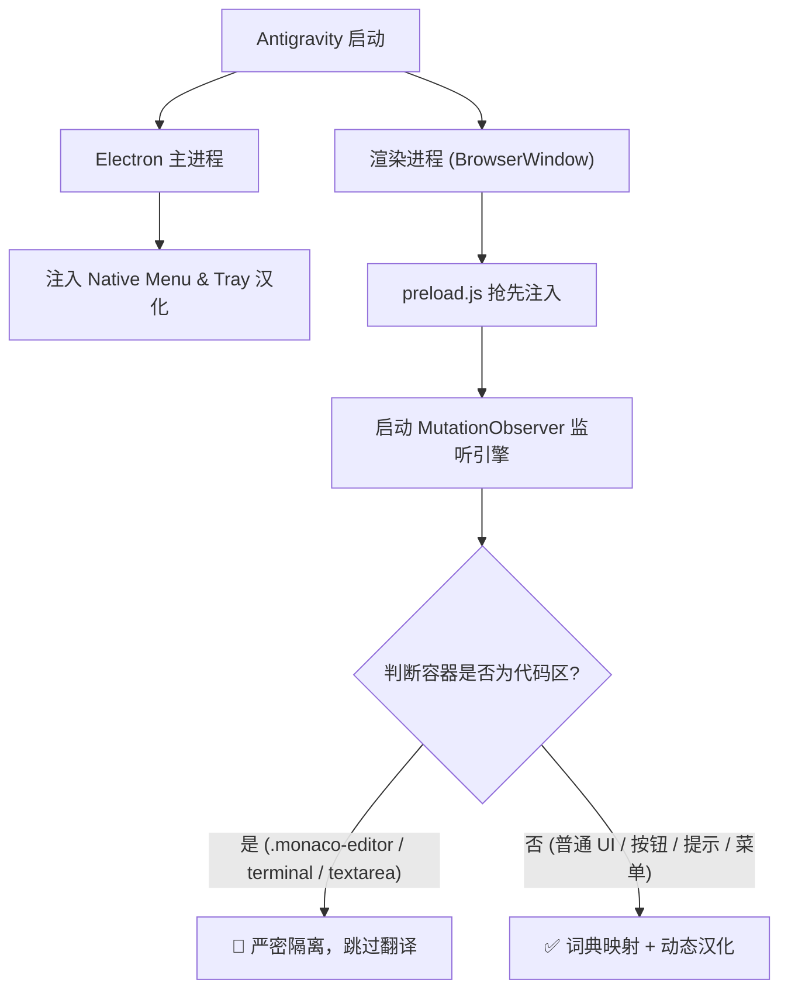

# Google Antigravity 中文汉化包 (Antigravity Chinese Localization)

<p align="center">
  
</p>

<p align="center">
  <b>让 Google Antigravity 拥有原生般丝滑的纯正中文体验</b><br>
  物理级代码隔离 · 全量词库覆盖 · 市场技能汉化 · 跨平台一键部署 · 随官方版本无痛升级
</p>

<p align="center">
  <a href="https://github.com/xukuncai-hub/antigravity-chinese/stargazers"></a>
  <a href="https://github.com/xukuncai-hub/antigravity-chinese/releases"></a>
  
  
  <a href="https://github.com/xukuncai-hub/antigravity-chinese/blob/main/LICENSE"></a>
  <a href="https://github.com/xukuncai-hub/antigravity-chinese/pulls"></a>
</p>

<p align="center">
  <a href="#-特性亮点">特性亮点</a> •
  <a href="#-对比优势">对比优势</a> •
  <a href="#-快速开始">快速开始</a> •
  <a href="#-搭配推荐网络加速">搭配网络加速</a> •
  <a href="#-手动安装免环境依赖">手动替换</a> •
  <a href="#-工作原理">核心原理</a> •
  <a href="#-更新记录">更新日志</a> •
  <a href="#-常见问题-faq">常见问题</a>
</p>

---

> [!TIP]
> 🚀 **国内网络加速推荐**：如果您在使用 Antigravity 时遇到连接超时、网络卡顿，或者必须开启全局代理 / TUN 虚拟网卡才能使用，强烈推荐搭配使用我们的兄弟项目：**[Google Antigravity 智能代理适配与专线加速引擎 (antigravity-proxy)](https://github.com/xukuncai-hub/antigravity-proxy)**，免开 TUN、免全局模式，完美支持普通系统代理与规则模式！

---

## ✨ 特性亮点

- 🛡️ **物理隔离引擎（V12.0 终极隔离版）**：基于 DOM 容器向上回溯算法，精准锁定并跳过 Monaco 代码编辑器、终端（xterm.js）、代码 Diff 与 Prompt 输入框，**绝对不会误翻译代码、文件路径与变量名**。
- 🧩 **全量插件市场与扩展技能汉化**：
  - 完整汉化 Antigravity 插件市场 7 大货架、全部 67 款扩展插件及详细介绍；
  - 覆盖市场内置的 **576 项扩展技能（Skills）** 与 **16 项规则规范（Rules）** 的中文功能说明；
  - 详情面板（概览、技能、MCP、规则、智能体等）全量中文化。
- ⚙️ **设置与交互全面板汉化**：
  - **设置中心（Settings）**：常规、外观主题、模型、快捷键、账户与沙箱网络/文件权限全量汉化；
  - **辅助侧边栏（Auxiliary Pane）**：子智能体（Subagents）、后台任务（Background Tasks）、工件（Artifacts）、文件变更（Files Changed）、终端（Terminals）完整汉化；
  - **原生菜单栏与托盘**：顶部原生菜单（文件、编辑、视图、窗口等）与系统托盘右键菜单全量覆盖；
  - **内置技能自动同步**：自动检测并同步汉化 `~/.gemini/antigravity/builtin/skills` 下的所有官方内置技能。
- 🔄 **版本更新无痛适配**：官方推送更新后，仅需双击运行一次安装脚本即可秒级重新注入适配；默认禁用后台静默自动下载，杜绝补丁被无声覆盖。
- 💻 **跨平台支持**：全面兼容 Windows、macOS 与 Linux。

---

## 📊 对比优势

| 维度 | Google 原生英文版 | 传统通用翻译插件 | 本汉化包 (Antigravity Chinese) |
| :--- | :---: | :---: | :---: |
| **界面语言** | 纯英文 | 部分翻译 / 页面漂移 | **纯正原生级全量中文** |
| **代码区保护** | 原生 | 经常误翻变量/注释/路径 | **物理级 DOM 隔离，绝对不碰代码** |
| **插件市场与技能** | 纯英文 | 无法抓取动态加载内容 | **全量 67 款插件 + 576 项技能汉化** |
| **设置与原生菜单** | 纯英文 | 无法处理 Electron 原生层 | **菜单栏 + 托盘 + 设置中心全量覆盖** |
| **安装与卸载** | - | 依赖扩展商店 | **双击脚本一秒部署，支持一键无痛还原** |
| **静默覆盖防护** | 官方后台覆盖 | 覆盖即失效 | **内置防静默覆盖补丁，稳定持久** |

---

## 🚀 快速开始

### 前置要求
- 已安装 **Google Antigravity**；
- 系统已安装 **Node.js**（推荐）或 **Python 3**。

### 方式一：一键自动安装（推荐）

#### 🪟 Windows
克隆本仓库后，直接**双击运行目录下的 `install.bat`** 即可一键完成全套汉化！

也可以打开 PowerShell 执行：
```powershell
git clone https://github.com/xukuncai-hub/antigravity-chinese.git
cd antigravity-chinese
.\install.ps1
```

*脚本会自动检测 Antigravity 安装目录，备份官方原版，全量注入汉化补丁并自动同步内置技能。*

#### 🐧 Linux / 🍎 macOS
打开终端执行以下命令：
```bash
git clone https://github.com/xukuncai-hub/antigravity-chinese.git
cd antigravity-chinese
chmod +x install.sh
./install.sh
```

> [!TIP]
> 安装前建议彻底退出 Antigravity（包括系统托盘图标）。完成后重新打开软件即可生效！

---

## 🔌 搭配推荐：网络加速

如果你在中国大陆网络环境下使用 Google Antigravity，经常会遇到 **“核心断连、模型无响应、必须开启虚拟网卡 (TUN) 或全局模式”** 的网络痛点。

我们开发了专用的网络自适应加速引擎：
👉 **[Google Antigravity 智能代理适配与专线加速引擎 (antigravity-proxy)](https://github.com/xukuncai-hub/antigravity-proxy)**

- ⚡ **突破底层 Go 核心代理限制**：彻底免去开启虚拟网卡 (TUN) 驱动；
- ⚡ **支持常用规则模式**：国内网站满速直连，不再受全局模式拖慢；
- ⚡ **智能感知与自动分流**：Clash Verge / Clash / v2rayN 等常见客户端即插即用。

---

## 📦 手动安装（免环境依赖）

如果你没有安装 Node.js 环境，可以直接下载我们预先打包好的 `app.asar` 文件直接替换：

1. 前往 **[Releases 页面](https://github.com/xukuncai-hub/antigravity-chinese/releases)** 下载对应版本的 `app.asar`；
2. 找到你的 Antigravity 安装目录下的 `resources` 文件夹：
   - **Windows**: `C:\Users\<你的用户名>\AppData\Local\Programs\Antigravity\resources\`
   - **macOS**: `/Applications/Antigravity.app/Contents/Resources/`
   - **Linux**: `~/.local/share/Antigravity/resources/`
3. 将原来的 `app.asar` 重命名为 `app.asar.bak` 作备份；
4. 将下载的 `app.asar` 复制进去，重启软件即可！

---

## 📝 最近更新日志

### [v1.0.9] - 2026-11-14
- **适配 Antigravity 2.32.1**：全面兼容官方最新发布的 2.32.1 版本。
- **四重防静默覆盖机制**：新增禁用退出时静默安装、拦截后台定时轮询检查、拦截后台核心进程更新调用，并自动清除残留安装包缓存，彻底杜绝无感覆盖。

### [v1.0.8] - 2026-11-13
- **适配 Antigravity 2.31.2**：精准更新多处补丁锚点，全面兼容官方最新版本。
- **禁用后台静默自动更新**：在更新补丁中默认将 `autoDownload` 设置为 `false`，彻底解决官方后台静默下载覆盖导致汉化和代理失效的问题。
- **原生 Node.js 安装脚本**：新增纯 Node.js 安装器 `install.js`，实现无需 Python 运行环境即可一键解包与注入；`install.bat` 升级为优先使用 Node.js 运行。
- **主页 Banner 路径优化**：修复主页 Banner 图片在网络受限环境下的加载问题。

### [v1.0.6] - 2026-11-04
- **全方位设置与面板汉化**：全面逆向提取并汉化 Antigravity 2.29.0 中的常规设置、外观、快捷键动作、辅助侧边栏、终端沙箱配置与全量交互对话框（共新增 695 条核心词条）。

### [v1.0.5] - 2026-11-04
- **适配 Antigravity 2.29.0**：完美兼容官方最新版本。
- **集成内置技能自动同步**：新增 `builtin_skills_zh/` 离线词库，安装时自动检测并汉化官方 9 项内置技能。
- **新增 Windows `install.bat`**：支持双击一键执行安装与升级。

### [v1.0.4] - 2026-11-01
- **市场全量规则与技能中文化**：全面覆盖 67 款插件、576 项扩展技能与 16 项规则规范的中文说明。

---

## ⏪ 一键还原为官方英文

如果需要恢复为 Google 官方原生英文版：

```bash
node install.js --restore
```
*(若系统安装了 Python 也可以运行 `python3 install.py --restore`)*，或直接将之前备份的 `app.asar.bak` 改回 `app.asar` 即可。

---

## 🛠️ 工作原理

Google Antigravity 基于 Electron 开发，核心逻辑封装在 `resources/app.asar` 中：



---

## ❓ 常见问题 (FAQ)

<details>
<summary><b>Q1: 汉化会影响代码生成或 AI 回复质量吗？</b></summary>
完全不会。物理隔离引擎会严格保护代码编辑器、终端和 Prompt 输入区域，底层大模型通信完全保持原生。
</details>

<details>
<summary><b>Q2: 提示「未自动找到 Antigravity 的 app.asar 文件」怎么办？</b></summary>
可以使用 <code>--path</code> 参数手动指定路径，例如：<br>
<code>node install.js --path /your/custom/path/resources/app.asar</code>
</details>

<details>
<summary><b>Q3: 软件更新后汉化失效了怎么办？</b></summary>
在 v1.0.8 及更高版本中，补丁已默认禁用后台静默下载，减少自动覆盖情况。若您主动更新了官方版本，只需进入本仓库重新双击 <code>install.bat</code> 即可秒级重新注入并恢复汉化！
</details>

<details>
<summary><b>Q4: 是否支持 macOS 和 Linux？</b></summary>
支持。在 macOS 和 Linux 终端中运行 <code>./install.sh</code> 即可自动适配并注入。
</details>

---

## 🌐 English Introduction

**Google Antigravity Chinese Localization Package** provides a native-like, high-performance Chinese translation experience for Google Antigravity (the agentic AI development environment). Features include:
- **Zero Interference with Code**: Strict DOM isolation ensures code editors (Monaco), terminals, and AI prompt inputs remain 100% untouched.
- **Full Coverage**: Translates UI, native menus, settings, and over 67 marketplace plugins + 576 extension skills.
- **One-Click Setup**: Zero-configuration installer script for Windows, macOS, and Linux.

---

## 🔍 搜索关键词 (Keywords)

`Google Antigravity 汉化` · `Antigravity 中文包` · `Antigravity 汉化补丁` · `Antigravity Chinese Localization` · `Antigravity 界面汉化` · `Google AI IDE 汉化` · `Gemini Antigravity 中文` · `Antigravity 插件汉化` · `Antigravity 设置中文` · `Antigravity 教程` · `DeepMind Antigravity`

---

## 📄 开源许可证

本项目基于 [MIT License](LICENSE) 开源。欢迎提交 Issue 和 Pull Request 一起完善汉化词库！
