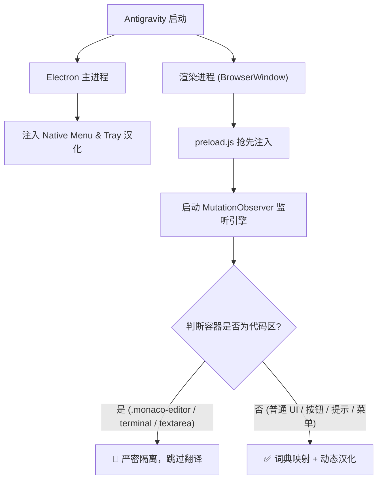

# Google Antigravity 中文汉化包 (Antigravity Chinese Localization)

<p align="center">
  
</p>

<p align="center">
  <b>让 Google Antigravity 拥有原生般丝滑的纯正中文体验</b><br>
  物理级代码隔离 · 全量词库覆盖 · 市场技能汉化 · 跨平台一键部署 · 随官方版本无痛升级
</p>

<p align="center">
  <a href="#-特性亮点">特性亮点</a> •
  <a href="#-快速开始">快速开始</a> •
  <a href="#-手动安装免环境依赖">手动替换</a> •
  <a href="#-工作原理">核心原理</a> •
  <a href="#-更新记录">更新日志</a> •
  <a href="#-一键还原">一键还原</a> •
  <a href="#-常见问题">常见问题</a>
</p>

---

## ✨ 特性亮点

- 🛡️ **物理隔离引擎（V12.0 终极隔离版）**：基于 DOM 容器向上回溯算法，精准锁定并跳过 Monaco 代码编辑器、终端（xterm.js）、代码 Diff 与 Prompt 输入框，**绝对不会误翻译代码、文件路径与变量名**。
- 🧩 **全量插件市场与扩展技能汉化**：
  - 完整汉化 Antigravity 插件市场 7 大货架、全部 67 款扩展插件及详细介绍；
  - 覆盖市场内置的 **576 项扩展技能（Skills）** 与 **16 项规则规范（Rules）** 的中文功能说明；
  - 详情面板（概览、技能、MCP、规则、智能体等）全量中文化。
- ⚙️ **设置与交互全面板汉化**：
  - **设置中心（Settings）**：常规、外观主题、模型、快捷键、账户与沙箱网络/文件权限全量汉化；
  - **辅助侧边栏（Auxiliary Pane）**：子智能体（Subagents）、后台任务（Background Tasks）、工件（Artifacts）、文件变更（Files Changed）、终端（Terminals）完整汉化；
  - **原生菜单栏与托盘**：顶部原生菜单（文件、编辑、视图、窗口等）与系统托盘右键菜单全量覆盖；
  - **内置技能自动同步**：自动检测并同步汉化 `~/.gemini/antigravity/builtin/skills` 下的所有官方内置技能。
- 🔄 **版本更新无痛适配**：官方推送更新后，仅需双击运行一次安装脚本即可秒级重新注入适配，无需苦等第三方版本发布。
- 💻 **全平台支持**：支持 Windows、macOS 与 Linux。

---

## 🚀 快速开始

### 前置要求
- 已安装 **Google Antigravity**；
- 系统已安装 **Python 3** 与 **Node.js / npx**（用于解包与打包 asar）。

### 方式一：一键自动安装（推荐）

#### 🪟 Windows
克隆本仓库后，直接**双击运行目录下的 `install.bat`** 即可一键完成全套汉化！

也可以打开 PowerShell 执行：
```powershell
git clone https://github.com/xukuncai-hub/antigravity-chinese.git
cd antigravity-chinese
.\install.ps1
```

*脚本会自动检测 Antigravity 安装目录，备份官方原版，全量注入汉化补丁并自动同步内置技能。*

#### 🐧 Linux / 🍎 macOS
打开终端执行以下命令：
```bash
git clone https://github.com/xukuncai-hub/antigravity-chinese.git
cd antigravity-chinese
chmod +x install.sh
./install.sh
```

> [!TIP]
> 安装前建议彻底退出 Antigravity（包括系统托盘图标）。完成后重新打开软件即可生效！

---

## 📦 手动安装（免环境依赖）

如果你没有安装 Node.js 环境，可以直接下载我们预先打包好的 `app.asar` 文件直接替换：

1. 前往 **[Releases 页面](https://github.com/xukuncai-hub/antigravity-chinese/releases)** 下载最新版本的 `app.asar`；
2. 找到你的 Antigravity 安装目录下的 `resources` 文件夹：
   - **Windows**: `C:\Users\<你的用户名>\AppData\Local\Programs\Antigravity\resources\`
   - **macOS**: `/Applications/Antigravity.app/Contents/Resources/`
   - **Linux**: `~/.local/share/Antigravity/resources/`
3. 将原来的 `app.asar` 重命名为 `app.asar.bak` 作备份；
4. 将下载的 `app.asar` 复制进去，重启软件即可！

---

## 📝 最近更新日志

### [v1.0.8] - 2026-11-13
- **适配 Antigravity 2.31.2**：精准更新多处补丁锚点，全面兼容官方最新版本。
- **禁用后台静默自动更新**：在更新补丁中默认将 `autoDownload` 设置为 `false`，彻底解决官方后台静默下载覆盖导致汉化和代理失效的问题。
- **原生 Node.js 安装脚本**：新增纯 Node.js 安装器 `install.js`，实现无需 Python 运行环境即可一键解包与注入；`install.bat` 升级为优先使用 Node.js 运行。
- **主页 Banner 路径优化**：修复主页 Banner 图片在网络受限环境下的加载问题。

### [v1.0.6] - 2026-11-04
- **全方位设置与面板汉化**：全面逆向提取并汉化 Antigravity 2.29.0 中的常规设置、外观、快捷键动作、辅助侧边栏、终端沙箱配置与全量交互对话框（共新增 695 条核心词条）。

### [v1.0.5] - 2026-11-04
- **适配 Antigravity 2.29.0**：完美兼容官方最新版本。
- **集成内置技能自动同步**：新增 `builtin_skills_zh/` 离线词库，安装时自动检测并汉化官方 9 项内置技能。
- **新增 Windows `install.bat`**：支持双击一键执行安装与升级。

### [v1.0.4] - 2026-11-01
- **市场全量规则与技能中文化**：全面覆盖 67 款插件、576 项扩展技能与 16 项规则规范的中文说明。

---

## ⏪ 一键还原为官方英文

如果需要恢复为 Google 官方原生英文版：

```bash
python3 install.py --restore
```
或直接将之前备份的 `app.asar.bak` 改回 `app.asar` 即可。

---

## 🛠️ 工作原理

Google Antigravity 基于 Electron 开发，核心逻辑封装在 `resources/app.asar` 中：



---

## ❓ 常见问题 (FAQ)

<details>
<summary><b>Q1: 汉化会影响代码生成或 AI 回复质量吗？</b></summary>
完全不会。物理隔离引擎会严格保护代码编辑器、终端和 Prompt 输入区域，底层大模型通信完全保持原生。
</details>

<details>
<summary><b>Q2: 提示「未自动找到 Antigravity 的 app.asar 文件」怎么办？</b></summary>
可以使用 <code>--path</code> 参数手动指定路径，例如：<br>
<code>python3 install.py --path /your/custom/path/resources/app.asar</code>
</details>

<details>
<summary><b>Q3: 软件更新后汉化失效了怎么办？</b></summary>
Google Antigravity 每次推送新版本会自动重置 <code>app.asar</code>。更新完成后，进入本仓库双击 <code>install.bat</code>（或执行 <code>.\install.ps1</code> / <code>./install.sh</code>）即可秒级重新注入并恢复汉化！
</details>

---

## 📄 开源许可证

本项目基于 [MIT License](LICENSE) 开源。
欢迎提交 Issue 和 Pull Request 一起完善汉化词库！
