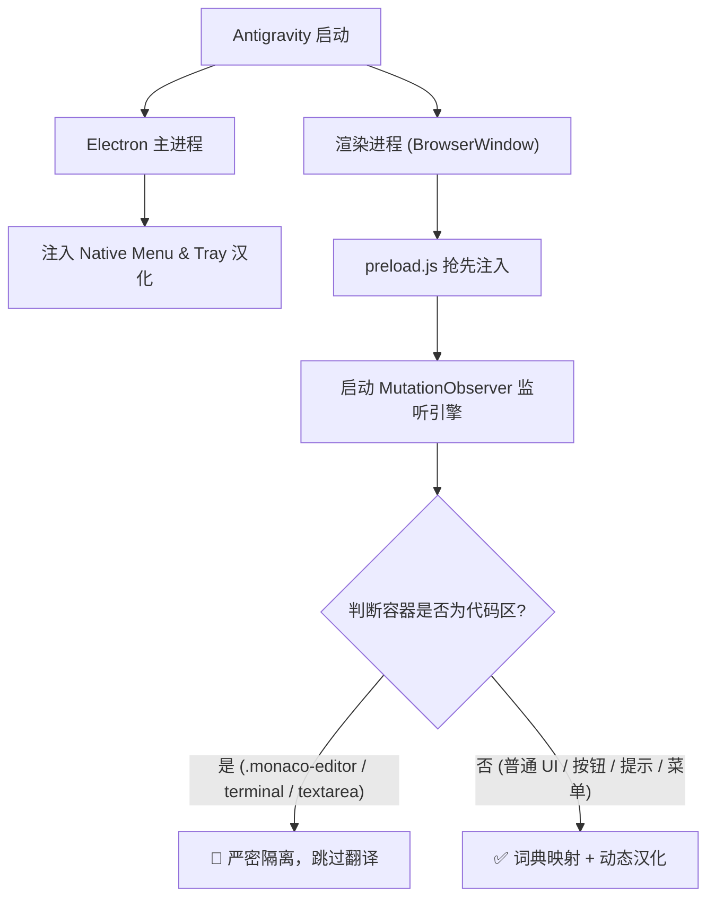

# Google Antigravity 中文汉化包 (Antigravity Chinese Localization)

<p align="center">
  
</p>

<p align="center">
  <b>让 Google Antigravity 拥有原生般丝滑的纯正中文体验</b><br>
  物理级代码隔离 · 全量词库覆盖 · 跨平台一键部署 · 随官方版本无痛升级
</p>

<p align="center">
  <a href="#-特性亮点">特性亮点</a> •
  <a href="#-快速开始">快速开始</a> •
  <a href="#-手动安装免代码">手动替换</a> •
  <a href="#-工作原理">核心原理</a> •
  <a href="#-一键还原">一键还原</a> •
  <a href="#-常见问题">常见问题</a>
</p>

---

## ✨ 特性亮点

- 🛡️ **物理隔离引擎（V12.0 终极隔离版）**：基于 DOM 容器向上回溯算法，精准锁定并跳过 Monaco 代码编辑器、终端（xterm.js）、代码 Diff 与 Prompt 输入框，**绝对不会误翻译代码与变量名**。
- 🌐 **全方位多层级汉化**：
  - **Web 视图层**：任务卡片、Artifacts 面板、聊天交互、设置选项等全量汉化；
  - **原生菜单栏**：文件、编辑、视图、窗口、帮助等原生一级/二级菜单及快捷键提示；
  - **系统托盘**：智能体后台运行数量、右键菜单、双击还原窗口交互；
  - **系统更新**：更新检查与通知对话框全面本地化。
- 🔄 **版本更新不失效**：官方发布新版本后，仅需重新运行一次安装脚本即可自动适配，无需苦等第三方重新打包。
- 💻 **全平台支持**：支持 Linux、macOS 与 Windows。

---

## 🚀 快速开始

### 前置要求
- 已安装 **Google Antigravity**；
- 系统已安装 **Python 3** 与 **Node.js / npx**（用于解包与打包 asar）。

### 方式一：一键自动安装（推荐）

#### 🐧 Linux / 🍎 macOS
打开终端执行以下命令：
```bash
git clone https://github.com/xukuncai-hub/antigravity-chinese.git
cd antigravity-chinese
chmod +x install.sh
./install.sh
```

#### 🪟 Windows
以管理员或普通用户身份打开 PowerShell 执行：
```powershell
git clone https://github.com/xukuncai-hub/antigravity-chinese.git
cd antigravity-chinese
.\install.ps1
```

*脚本会自动检测 Antigravity 的安装目录，备份原始文件并自动注入汉化补丁。完成后重启软件即可！*

---

## 📦 手动安装（免环境依赖，适合小白）

如果你没有安装 Node.js 环境，可以直接下载我们预先打包好的 `app.asar` 文件直接替换：

1. 前往 **[Releases 页面](https://github.com/xukuncai-hub/antigravity-chinese/releases)** 下载最新版本的 `app.asar`；
2. 找到你的 Antigravity 安装目录下的 `resources` 文件夹：
   - **Linux**: `~/.local/share/Antigravity/resources/`
   - **macOS**: `/Applications/Antigravity.app/Contents/Resources/`
   - **Windows**: `C:\Users\<你的用户名>\AppData\Local\Programs\Antigravity\resources\`
3. 将原来的 `app.asar` 重命名为 `app.asar.bak` 作备份；
4. 将下载的 `app.asar` 复制进去，重启软件即可！

---

## ⏪ 一键还原为官方英文

如果需要恢复为 Google 官方原生英文版：

```bash
python3 install.py --restore
```
或直接将之前备份的 `app.asar.bak` 改回 `app.asar` 即可。

---

## 🛠️ 工作原理

Google Antigravity 基于 Electron 开发，核心逻辑封装在 `resources/app.asar` 中：



---

## ❓ 常见问题 (FAQ)

<details>
<summary><b>Q1: 汉化会影响代码生成或 AI 回复质量吗？</b></summary>
完全不会。汉化补丁仅作用于前端展示层与 Electron 菜单层，底层与大模型的 Prompt 通信和代码生成完全保持独立与原生。
</details>

<details>
<summary><b>Q2: 提示「未自动找到 Antigravity 的 app.asar 文件」怎么办？</b></summary>
可以使用 <code>--path</code> 参数手动指定路径，例如：<br>
<code>python3 install.py --path /your/custom/path/resources/app.asar</code>
</details>

<details>
<summary><b>Q3: 软件更新后汉化失效了？</b></summary>
官方推送更新会覆盖 <code>app.asar</code>。更新完成后，重新执行一次 <code>./install.sh</code> 或运行一次安装脚本即可秒恢复汉化。
</details>

---

## 📄 开源许可证

本项目基于 [MIT License](LICENSE) 开源。
欢迎提交 Issue 和 Pull Request 一起完善汉化词库！
